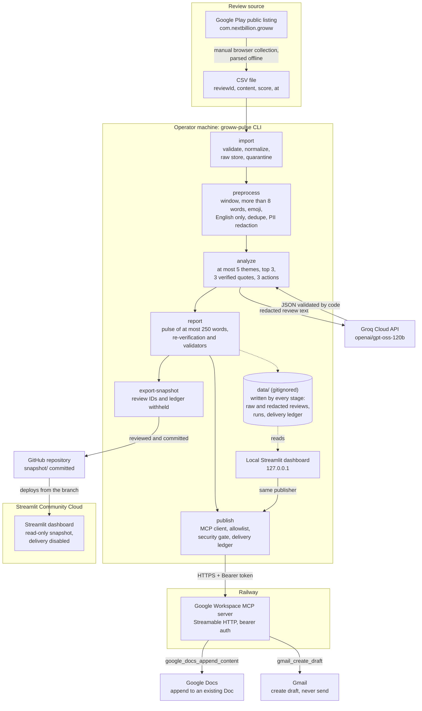

# Groww Review Pulse Agent

Turns public Google Play reviews of Groww (`com.nextbillion.groww`) into a weekly
product-feedback pulse of at most 250 words. The pulse has the top 3 themes, exactly 3
verbatim anonymized quotes, and exactly 3 action ideas. It is appended to a Google Doc,
and a Gmail **draft** is created, both through an MCP server. Email is never sent.

Apple App Store reviews are out of scope.

| | |
|---|---|
| GitHub repository | <https://github.com/Tanveer8932/groww-review-pulse-agent> (branch `feature/streamlit-dashboard-week-lock`) |
| Dashboard (Streamlit Community Cloud) | Deployed from this repository and branch; read-only snapshot. The public app URL is not recorded in the repository yet (see [Documentation gaps](#documentation-gaps)) |
| MCP server (Railway) | `https://mcp-server-4-production-b6ec.up.railway.app/`: a Railway deployment of the Google Workspace MCP server (`mcp-server-4`). It rejects requests without a valid bearer token |

Documentation:
- [Problem statement](docs/problemStatement.md)
- [Architecture](docs/architecture.md)
- [Implementation plan and status](docs/implementation-plan.md)
- [Observed MCP contract](docs/mcp-contract.md)
- [Data-source decision](docs/data-source-decision.md)
- [MCP server security assessment](docs/mcp-server-security.md)

## Problem statement and objectives

Groww receives a steady stream of public Google Play reviews about login, KYC, order
execution, the UI, and customer support. Product teams need a short, repeatable weekly
signal from them. Summarizing by hand is slow and prone to cherry-picking, and an
unchecked LLM summary can invent quotes, numbers, or deliveries that never happened.
The full statement is in [docs/problemStatement.md](docs/problemStatement.md).

Objectives:
1. Import public Groww reviews from an 8–12-week window, from files only (no scraping).
2. Keep English reviews with more than 8 words, apply the emoji policy, deduplicate, and
   redact PII before any text reaches the LLM.
3. Group the reviews into at most 5 themes and rank them, then pick the top 3.
4. Produce a pulse of at most 250 words with 3 code-verified verbatim quotes and 3 action
   ideas. Every number in it is computed by code.
5. Deliver it through the MCP server: append to a Google Doc and create a Gmail draft, at
   most once per ISO week, with no send path.
6. Show the result in a Streamlit dashboard.

## Tech stack

| Area | Used |
|---|---|
| Language and packaging | Python 3.11 (CI also runs 3.12), `uv`, `pyproject.toml` (hatchling), `uv.lock`, `requirements.txt` exported from the lock |
| CLI | Typer (`groww-pulse`) |
| Configuration | pydantic-settings (environment variables or `.env`) |
| Data and text | pandas, `emoji`, `lingua-language-detector`, `rapidfuzz`, scikit-learn (TF-IDF ranking of quote candidates, KMeans fallback clustering) |
| LLM | Groq Cloud (`groq` SDK, model `openai/gpt-oss-120b`, strict JSON-schema output). Anthropic (`anthropic` SDK) is a supported alternative provider |
| MCP | Official `mcp` Python SDK, Streamable HTTP transport, `httpx` |
| Dashboard | Streamlit |
| Quality | pytest, pytest-cov, hypothesis, ruff, mypy (strict), pre-commit, detect-secrets, GitHub Actions CI, Dependabot |

## Architecture



Import, preprocessing, Groq analysis, report generation, and snapshot export run **only in
the CLI** on the operator's machine. Delivery runs from the CLI or from a local dashboard,
which both use the same publisher. Neither dashboard can upload reviews or run a pipeline
stage. The CLI commands are listed in [CLI commands](#cli-commands).

### Two deployments

| Deployment | What runs there | What it can do |
|---|---|---|
| **Streamlit Community Cloud** | `app/streamlit_app.py` from this repository. `data/` is gitignored, so the app has no review data, run outputs, or delivery ledger. It shows the committed read-only snapshot in `snapshot/` | Shows the verified Week 42 pulse, its themes, quotes, actions, and aggregate statistics, and the per-target delivery status recorded at export. Delivery, preview, and analysis are disabled |
| **Railway: MCP server** | The Google Workspace MCP server (`mcp-server-4`, Node.js), a separate project. It holds the Google OAuth tokens; this repository holds none | Exposes `google_docs_append_content` and `gmail_create_draft` over Streamable HTTP. The CLI (and a local dashboard) call it with `MCP_AUTH_TOKEN` |

This agent itself is not deployed on Railway. There is no Dockerfile or Railway
configuration for it in this repository.

## Review source and collection

- **Source:** the public Google Play listing of Groww (`com.nextbillion.groww`).
- **Collection method:** the operator collected reviews **manually** through the public
  browser interface, saved the browser's network responses, and parsed them **offline**
  into a CSV (`reviewId, content, score, at`). Nothing in this project fetched anything.
- **No automated collector.** Google Play's robots.txt disallows the review endpoints, and
  Google's Terms forbid automated access contrary to it, so collection is rejected.
  `groww-pulse collect` always refuses with `CollectorDisabledError`. Reviews enter only
  through `groww-pulse import` (CSV, JSON, or JSONL, including the Play Console CSV
  format). Details are in [docs/data-source-decision.md](docs/data-source-decision.md).
- **Window:** `ANALYSIS_WINDOW_WEEKS` must be 8–12 (default 12), ending on the `--as-of`
  date. Reviews outside it are excluded.
- **Dataset used for the real run** (2026-10-14, `--as-of 2026-10-14`):
  - 73 rows imported, 0 quarantined;
  - target window 2026-07-23 to 2026-10-14 (12 weeks);
  - actual review dates 2026-07-24 to 2026-09-19. The last 3.5 weeks of the window have no
    reviews.

  It is a small, non-random sample: 55% of the reviews are 1★, and app versions are
  absent. The source has no legal or licence approval yet (see
  [Known limitations](#known-limitations)).

## Data preprocessing

`groww-pulse preprocess` applies these steps in a fixed order and records a funnel with
the count and reason for every drop:

| Step | Rule |
|---|---|
| Validate and normalize | Unicode NFC, whitespace collapsed, control characters stripped. The original text stays in the restricted raw store |
| Window | Inside the 8–12-week window |
| Length | **More than 8 words** (`MIN_WORDS_EXCLUSIVE=8`) |
| Emoji | `EMOJI_POLICY=strict` (default) drops any review containing an emoji. `lenient` drops emoji-only reviews and never quotes the rest. Text is never altered |
| Language | **English only.** `lingua` detection with confidence ≥ `LANG_MIN_CONFIDENCE` (0.80). Below that, an optional lexical rescue keeps English scoring 0.50–0.80 only when ≥ 85% of its ordinary words are English. Hinglish and non-Latin scripts are excluded |
| Deduplicate | Same review ID, same normalized text, or near-duplicate (`rapidfuzz` token-set ratio ≥ 95 among same-rating reviews) |
| PII redaction | Emails, phone numbers, PAN, Aadhaar (checksum), UPI IDs, account and card numbers (Luhn), URLs, addresses, and names are replaced with typed placeholders such as `[EMAIL]`. Reviewer names, avatars, and profile links are never stored |
| Length re-check and output gate | The length rule runs again after redaction, and a final gate checks every stored review |

Only redacted text leaves this layer. Reviews that look truncated or spliced are kept for
theming but are not quoted (quote holds).

Real run: 73 → 67 reviews, with 6 dropped for emoji, 0 PII redactions, and 60 reviews
eligible for quoting.

## AI workflow

`groww-pulse analyze` uses **Groq** (`LLM_PROVIDER=groq`, model `openai/gpt-oss-120b`,
strict JSON-schema output). Code validates every response, and the LLM
receives only review IDs and redacted text.

1. **Theme discovery:** from a stratified sample, the LLM proposes **at most 5** themes.
   Code enforces 1–5 unique, non-empty, non-catch-all names.
2. **Assignment:** every review is mapped to one theme or `other` in batches. Unknown or
   missing IDs are rejected.
3. **Ranking (code):** `score = count × (1 + low_rating_share)`, where `low_rating_share`
   is the share of 1–2★ reviews. The **top 3** themes are selected.
4. **Quotes (code, never the LLM):** **3 verbatim quotes**, ideally one per top theme. Each
   is a contiguous span of whole sentences (9–35 words) from a review's redacted text,
   verified with `review.text[start:end] == quote`. With fewer than 3 verified quotes, the
   run fails.
5. **Actions:** the LLM writes **3 action ideas**. Each is tied to a top theme, starts with
   a verb, has at most 25 words, and names an owner area. It must not contain numbers that
   are absent from the computed statistics.
6. **Fallback:** if the provider is unavailable, TF-IDF + KMeans clustering runs instead,
   and the pulse is labelled `fallback_clustering`. The real run used the LLM, with no
   fallback.

Groq's free tier allows about 8,000 tokens per minute. The client keeps every request under
`GROQ_TOKENS_PER_MINUTE`, caps output at `GROQ_MAX_OUTPUT_TOKENS`, and paces calls instead
of failing. The run budget is `LLM_MAX_TOKENS_PER_RUN`. The configured model is the only
one called. Anthropic remains available with `LLM_PROVIDER=anthropic` and
`ANTHROPIC_API_KEY`.

### Weekly report

`groww-pulse report` makes no LLM calls. It re-verifies the analysis first:
- the integrity hash;
- the unchanged review store;
- every statistic and the ranking, recomputed;
- the quotes, against the reviews and the raw store;
- the actions.

It then renders `pulse.txt`, `pulse.md`, and `pulse.json`. Every validator must pass:
- **at most 250 words**;
- exactly 3 themes, 3 quotes, and 3 actions;
- the quotes re-verified;
- every number computed by code;
- no PII;
- no synthetic data.

The committed real pulse,
[`snapshot/runs/20261017T064855Z-4dc798/pulse.txt`](snapshot/runs/20261017T064855Z-4dc798/pulse.txt),
is for ISO week 2026-W42 and has 211 words, 67 reviews analyzed of 73 collected, and these
top themes:
1. Customer support responsiveness;
2. Order execution and trading bugs;
3. UI/UX complexity and forced updates.

## Google Docs and Gmail delivery (MCP)

`groww-pulse publish` sends the verified `pulse.txt` through the MCP server:
`google_docs_append_content` appends it to the Doc named by `GOOGLE_DOC_ID`, and
`gmail_create_draft` creates a draft for `PULSE_EMAIL_TO`.

- **No send path.** A code-level allowlist permits only those two tools. Calling
  `gmail_send_email` raises `ForbiddenToolError` before any network call.
- **Dry run by default.** Without flags, `publish` makes no network calls and shows the
  exact tool arguments, with the Doc ID and recipients masked. Live delivery needs
  `--confirm` **and** `DELIVERY_MODE=confirm`.
- **Security gate.** Live delivery also needs `MCP_AUTH_TOKEN`. Before writing, the client
  checks that the server rejects a handshake with no token and one with a wrong token. If
  either is accepted, nothing is written, and there is no override.
- **Health check.** `groww-pulse check-mcp` performs `initialize` and `tools/list` and
  checks the tool contract. A 200 from the root URL is not treated as healthy.
- **Idempotency.** The ledger `data/runs/ledger.jsonl` is append-only and has one key per
  target (week, content hash, Doc or recipients). A re-run skips what succeeded. An
  unknown outcome blocks the target until the operator checks the Doc and Drafts and
  re-runs with `--force`.
- **One version per ISO week.** Once any target received a version of a week, a pulse
  with different content for that week is `blocked_week_already_delivered`, in the CLI and
  the UI alike. `--force` does not override this.

  A partly delivered version can still finish its other targets with
  `groww-pulse publish --pulse data/runs/<its run> --confirm` (the block message prints the
  path) or the "Finish the delivered version" section in the Delivery tab.
- Outcomes are taken only from the server's tool responses. `delivery.json` records them
  with secrets masked, and `email_sent` is always `false`.

## Local setup

Requires [uv](https://docs.astral.sh/uv/). It installs Python 3.11 if needed.

```bash
git clone https://github.com/Tanveer8932/groww-review-pulse-agent.git
cd groww-review-pulse-agent
git checkout feature/streamlit-dashboard-week-lock
uv python install 3.11
uv venv --python 3.11 .venv
# Windows: .venv\Scripts\activate    macOS/Linux: source .venv/bin/activate
uv pip install -e ".[dev]"      # or: pip install -e ".[dev]"
cp .env.example .env            # then fill in values; never commit .env
pre-commit install
```

On Windows, keep the project on a short path: one scikit-learn file exceeds `MAX_PATH`
under deep directories.

### Environment variables

Set these in `.env` (gitignored) or in the environment. Leave secrets out of every
committed file. [`.env.example`](.env.example) lists them all with placeholders.

| Variable | Purpose | Default / example |
|---|---|---|
| `APP_ID` | Play package | `com.nextbillion.groww` |
| `ANALYSIS_WINDOW_WEEKS` | Window, 8–12 | `12` |
| `MIN_WORDS_EXCLUSIVE` | Keep reviews with more words than this | `8` |
| `EMOJI_POLICY` | `strict` or `lenient` | `strict` |
| `LANG_MIN_CONFIDENCE` / `LANG_LEXICAL_RESCUE` | English detection | `0.80` / `true` |
| `LLM_PROVIDER` / `LLM_MODEL` | `groq` (used here) or `anthropic` (code default) | `groq` / `openai/gpt-oss-120b` |
| `GROQ_API_KEY` | Groq key (secret) | `<your Groq key>` |
| `ANTHROPIC_API_KEY` | Only for `LLM_PROVIDER=anthropic` (secret) | `<your Anthropic key>` |
| `GROQ_TOKENS_PER_MINUTE` / `GROQ_MAX_OUTPUT_TOKENS` / `LLM_MAX_TOKENS_PER_RUN` | Request sizing and budget | `8000` / `2500` / `150000` (in `.env.example`) |
| `ANALYSIS_MIN_REVIEWS` | Minimum reviews for analysis | `20` |
| `MCP_SERVER_URL` | MCP endpoint (the root path `/`) | `https://<your-mcp-server>/` |
| `MCP_AUTH_TOKEN` | Bearer token for the MCP server (secret) | `<plaintext token>` |
| `GOOGLE_DOC_ID` | Bare ID of the target Doc | `<doc id>` |
| `PULSE_EMAIL_TO` | Draft recipients, comma-separated | `<recipient@example.com>` |
| `DELIVERY_MODE` | `dry_run` or `confirm` | `dry_run` |
| `DATA_DIR` / `SNAPSHOT_DIR` | Data root / dashboard snapshot | `./data` / `snapshot/` next to `app/` |
| `RAW_RETENTION_DAYS`, `LOG_LEVEL`, `LOG_FORMAT` | Operations | `90`, `INFO`, `json` |

Google OAuth credentials belong to the MCP server's deployment, not to this agent.

### CLI commands

The pipeline runs one stage at a time. Each stage writes under `DATA_DIR` (default
`./data`, gitignored).

```bash
groww-pulse import data/imports --as-of YYYY-MM-DD    # CSV/JSON/JSONL → raw store
groww-pulse preprocess --as-of YYYY-MM-DD             # filter, dedupe, redact; funnel
groww-pulse analyze                                   # Groq: themes, quotes, actions
groww-pulse report                                    # render + verify pulse (no LLM)
groww-pulse check-mcp                                 # read-only MCP health + security gate
groww-pulse publish                                   # dry run: no network calls
groww-pulse publish --confirm                         # live; also needs DELIVERY_MODE=confirm
groww-pulse export-snapshot                           # read-only snapshot for the hosted UI
```

| Task | Command |
|---|---|
| Tests | `pytest` |
| Lint and format | `ruff check . && ruff format --check .` |
| Type check | `mypy` |
| Secret scan | `detect-secrets-hook --baseline .secrets.baseline $(git ls-files)` |
| Render a specific analysis | `groww-pulse report --analysis data/runs/<run_id>/analysis.json` |
| Deliver a specific pulse | `groww-pulse publish --pulse data/runs/<run_id> [--confirm]` |
| Re-deliver after an unknown outcome (after checking the Doc and Drafts) | `groww-pulse publish --confirm --force` |
| Verify the MCP contract (Phase 0 script, read-only) | `python scripts/check_mcp.py` |
| Re-lock dependencies | `uv lock && uv export --no-dev --no-hashes --no-emit-project -o requirements.txt` |

`requirements.txt` is exported from `uv.lock` for Streamlit Community Cloud. Do not edit it
by hand. After upgrading the PII rules or the language filter, re-run `preprocess` and
`analyze`, because older outputs fail the provenance check.

### Streamlit dashboard

```bash
streamlit run app/streamlit_app.py --server.address 127.0.0.1
```

The dashboard shows the newest weekly pulse that passes every publish check (hashes,
files, byte-for-byte re-render, all validators). Newer pulse files that fail are listed
with the reason and never shown as content. With no verified pulse in `DATA_DIR` and no
snapshot, it shows the CLI commands that produce one. Tabs:

- **Weekly pulse**: ISO week, word count, the validator checklist, the rendered report, and
  the exact plain text that delivery would send;
- **Themes, quotes & actions**: the top 3 themes with the ranking formula, the 3 verified
  quotes with their ratings and dates, and the 3 action ideas;
- **Review statistics**: the preprocessing funnel with exclusion reasons, quote holds, PII
  redaction counts, and the rating mix of each top theme (counts only; no review text other
  than the verified quotes is shown);
- **Delivery**: ledger status per target, the duplicate-week block with its reasons (and a
  section to finish a partly delivered version), a dry-run preview, the confirmed delivery
  button, and a read-only MCP health check;
- **Settings**: readiness and configuration, with secrets shown only as set / not set.

Delivery from a local dashboard uses the same publisher as the CLI. The confirmed button
stays disabled until:
- every validator passed;
- `DELIVERY_MODE=confirm`;
- the targets and `MCP_AUTH_TOKEN` are set;
- this exact pulse was previewed with a dry run in the session;
- the confirmation box is ticked.

There is no send control, and `--force` is CLI-only.

### Hosted dashboard (Streamlit Community Cloud)

`data/` is gitignored (raw reviews, the redacted store, caches, and the delivery ledger), so
a hosted app has no pulse of its own. It shows the committed **read-only snapshot** in
`snapshot/` instead, which is used only when `DATA_DIR` holds no verified pulse. A local
`DATA_DIR` always wins.

Refresh the snapshot after a new report, then review and commit `snapshot/`:

```bash
groww-pulse export-snapshot            # newest verified pulse; or --pulse data/runs/<run_id>
```

- **What is copied:** the verified pulse (`pulse.txt` and `pulse.md` byte-for-byte; in
  `pulse.json`, the themes, verbatim quotes, actions, numbers, body, content hash, and
  validator results), the preprocessing funnel counts, and the analysis method and input
  counts.
- **Real data only:** synthetic pulses are refused. The export re-runs every publish check
  on the source and again on the written copy. The dashboard checks it a third time when
  it loads.
- **What is withheld:**
  - Google Play review IDs: theme member lists are emptied, and quote IDs become
    `withheld-N`;
  - per-review theme assignments;
  - local paths and preprocessing settings;
  - LLM usage;
  - the whole delivery ledger.

  `snapshot/snapshot.json` keeps the SHA-256 of each source file, plus a per-target delivery
  summary as it stood at export, with no ledger keys, run IDs, Doc IDs, or recipients.
- **Delivery is disabled for a snapshot.** Without the ledger, duplicate protection can't
  work, so preview and delivery stay CLI-only.

**Deploying:** create the app on Streamlit Community Cloud from this repository, branch
`feature/streamlit-dashboard-week-lock`, main file `app/streamlit_app.py`. Then, in the
app's **Settings → Secrets**, add root-level TOML keys. Streamlit Cloud exposes them as
environment variables, which is where the app reads its settings. Never commit
`.streamlit/secrets.toml` (it is gitignored).

```toml
LLM_PROVIDER = "groq"      # the default model is then openai/gpt-oss-120b
GROQ_API_KEY = "<your Groq key>"
# Optional; leave unset for a view-only deployment (delivery from a snapshot is disabled).
# DELIVERY_MODE = "dry_run"
```

The dashboard itself never calls the LLM: analysis runs only in `groww-pulse analyze`. With
these secrets, the Settings tab reports "LLM analysis: configured", and the key is shown
only as set / not set.

## Test results

Run on 2026-10-19 on Windows, Python 3.11, at commit `61870f9`:

| Check | Result |
|---|---|
| `pytest` | **989 passed, 3 skipped**. The 3 skipped tests are opt-in live tests (real Groq and MCP), which need `RUN_LIVE_TESTS=1` |
| Coverage (`groww_pulse`, line + branch) | **97%** |
| `ruff check`, `ruff format --check` | Clean |
| `mypy` (strict; `src`, `scripts`, `app`) | Clean |
| pre-commit (including `detect-secrets` and `detect-private-key`) | All hooks pass |

Unit tests mock the LLM and MCP. MCP tests use a fake server that serves the tool
definitions recorded from the real server. Test fixtures are synthetic and labelled. The
only real data in the repository is the committed `snapshot/`, and
`tests/unit/test_snapshot.py` checks it with every publish check.

## Evidence from the real run

Taken from the local run records (`data/`, gitignored) and the committed snapshot:

| Date (UTC) | Step | Result |
|---|---|---|
| 2026-10-14 | `import`, `preprocess` | 73 imported, 0 quarantined; 67 kept (6 dropped for emoji); 60 quote-eligible |
| 2026-10-15 | `analyze`, `report` | Groq `openai/gpt-oss-120b`, LLM themes (no fallback); Week 42 pulse, content hash `6cac28a6…` |
| 2026-10-17 | Confirmed publish (`DELIVERY_MODE=confirm`) | Health check inside the publish: Railway MCP server healthy, `auth_enforced: true`, security gate passed. Google Doc: **delivered**. Gmail draft: **delivered**. `email_sent: false` |
| 2026-10-17 | `publish --confirm` again | Both targets `skipped_already_delivered`, with no new append or draft |
| 2026-10-17 | `report` (corrected Week 42) | New content hash `84d6f68b…`, 211 words, all validators pass. Both targets `blocked_week_already_delivered` by duplicate-week protection, so it was **not** delivered |
| 2026-10-18 | `export-snapshot` | The corrected Week 42 pulse committed in `snapshot/` for the hosted dashboard |

The delivered version (`6cac28a6…`) no longer re-renders under the current report code, so
the dashboard and the snapshot show the corrected version (`84d6f68b…`). Their delivery
status is "blocked: another version of this week was already delivered".

## Completed and pending functionality

| Functionality | Status |
|---|---|
| CSV / JSON / JSONL import, Play Console CSV mapping, quarantine | Done |
| Automated Google Play collection | Rejected by design (`collect` always refuses) |
| Preprocessing: window, length, emoji, English, dedupe, PII | Done; validated on the 73 real reviews |
| Groq analysis: at most 5 themes, top 3, 3 verified quotes, 3 actions | Done; run once on real data |
| Report of at most 250 words with validators | Done |
| MCP delivery: Doc append + Gmail draft, allowlist, security gate, ledger | Done; one real delivery on 2026-10-17 |
| Duplicate-week protection with partial-delivery recovery | Done (CLI and UI) |
| Local Streamlit dashboard with confirmed delivery | Done; tested with a fake publisher. The run records do not say whether the 2026-10-17 delivery came from the CLI or the dashboard |
| Hosted read-only dashboard with the committed snapshot | Done |
| Single `groww-pulse run` command / orchestrator | **Not built**: stages run one at a time |
| Uploading files or running stages from the dashboard | **Not built**: all processing is CLI-only |
| Weekly scheduling | **Not built**: runs are manual |
| Deploying this app on Railway (Dockerfile, persistent ledger volume) | **Not built** |
| Delivery from the hosted dashboard | **Disabled by design** (no ledger in the cloud) |

## Known limitations

- **Data source not approved.** The 73 reviews were collected manually from the public
  listing and parsed offline. There is no Play Console authorization, reuse licence, or
  legal review. [docs/data-source-decision.md](docs/data-source-decision.md) restricts the
  dataset to pipeline validation until that is closed.
- **Small, uneven sample.** The sample has 73 reviews and 55% are 1★. They cover
  2026-07-24 to 2026-09-19, and the last 3.5 weeks of the 12-week window are empty. Theme
  shares describe this sample, not Groww's user base. App versions are absent.
- **Static hosted view.** The hosted dashboard shows only the snapshot committed in Git. A
  new pulse appears there only after `export-snapshot`, a commit, and a redeploy.
- **Local ledger.** Idempotency depends on `data/runs/ledger.jsonl` on the operator's
  machine. Deleting it loses the history. Run one publish at a time.
- **Unknown outcomes need a human.** The MCP server has no read tool, so after an unknown
  outcome the operator must check the Doc and Drafts before `--force`.
- **Plain-text Doc append.** Markdown formatting isn't applied in the Doc. The draft holds
  the full pulse, not a Doc link.
- **Trust in the MCP server.** The client verifies that the server enforces bearer auth. It
  cannot verify which Google account the server uses.

## Assignment deliverables

| Deliverable | Where |
|---|---|
| Source code | `src/groww_pulse/` (pipeline, analysis, report, delivery), `app/streamlit_app.py` (dashboard), `scripts/check_mcp.py` |
| Tests | `tests/` (unit, integration, labelled synthetic fixtures); CI in `.github/workflows/ci.yml` |
| Weekly pulse of at most 250 words (real data) | [`snapshot/runs/20261017T064855Z-4dc798/pulse.md`](snapshot/runs/20261017T064855Z-4dc798/pulse.md) |
| Google Doc append and Gmail draft | Delivered through the Railway MCP server on 2026-10-17 (see [Evidence](#evidence-from-the-real-run)) |
| Deployed dashboard | Streamlit Community Cloud, read-only snapshot |
| Architecture and design | This README and [docs/architecture.md](docs/architecture.md) |
| Problem statement, plan, data-source decision, MCP contract, security assessment | [docs/](docs/) |

### Verifying the prototype

1. **Hosted dashboard:** open the Streamlit Cloud app. Expect the "Read-only snapshot of
   the 2026-W42 pulse" banner, 211 words, all validators passing, 3 themes, 3 quotes, 3
   actions, and the funnel 73 → 67. The Delivery tab shows both targets as blocked
   (already delivered) and no delivery controls.
2. **Locally, without secrets:** follow [Local setup](#local-setup), run `pytest`, then run
   the dashboard. With an empty `data/`, it shows the same committed snapshot.
3. **Check the snapshot's integrity:** `pytest tests/unit/test_snapshot.py`. It re-runs
   every publish check on `snapshot/` with no synthetic opt-in.
4. **End to end, with your own data and keys:** put an export in `data/imports/`, set
   `GROQ_API_KEY`, then run `import`, `preprocess`, `analyze`, and `report`, then
   `publish` (dry run). Live delivery also needs an MCP server that enforces bearer auth,
   plus `MCP_SERVER_URL`, `MCP_AUTH_TOKEN`, `GOOGLE_DOC_ID`, `PULSE_EMAIL_TO`, and
   `DELIVERY_MODE=confirm`. Use a test Doc and your own address.

### Documentation gaps

- The public Streamlit Community Cloud URL is not recorded here. Add it to the table at the
  top.
- The Google Doc and the Gmail draft from 2026-10-17 are evidenced by the MCP tool
  responses in the run records. No screenshot or manual-check record is in the repository.
