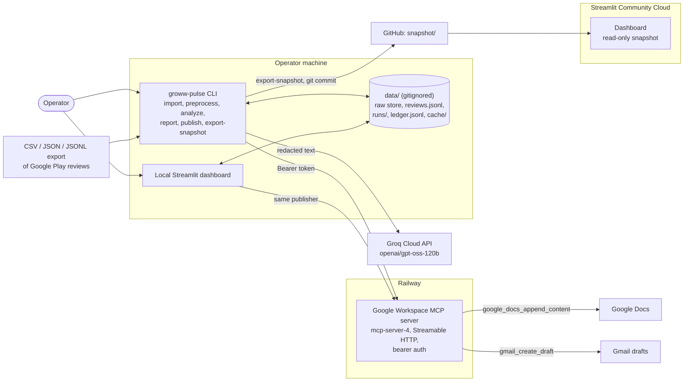

# Architecture — Groww Review Pulse Agent

| Field | Value |
|---|---|
| Document status | Draft v1 |
| Last updated | 2026-10-19 (as built: CLI-only processing, Groq, duplicate-week lock, read-only cloud snapshot, the two deployments) |
| Related docs | [problemStatement.md](problemStatement.md), [implementation-plan.md](implementation-plan.md) |

---

## 1. Architectural Principles

1. **Layered and separable.** Collection, preprocessing, analysis, reporting, and MCP delivery are independent packages. They communicate only through typed models and files, never through shared globals.
2. **Code owns facts; the LLM owns language.** Counts, dates, rankings, quote extraction, and word limits are computed and validated in code. The LLM proposes theme names, groupings, and action wording. Code validates every LLM output before use.
3. **Verify, never assume.** Quotes are verified against stored text. The MCP server is verified by an MCP `initialize` + `tools/list` handshake; a responding root URL proves nothing. Tool results are parsed, not presumed.
4. **Safe by default.** Dry-run is the default, the MCP tool allowlist blocks sending email, live collection is opt-in, and secrets come only from the environment.
5. **Idempotent where it matters.** Imports upsert by `review_id`, LLM replies are cached by a hash of the prompt, every stage records the hashes of its inputs so later stages can detect stale outputs, and delivery is keyed in a ledger so re-runs never re-deliver.
6. **Privacy before intelligence.** PII is redacted before text reaches the LLM, the UI, logs, or MCP.

## 2. System Context

As built, every processing stage is a separate CLI command run by the operator. There is
no orchestrator and no scheduler. The dashboards only read stored results; a local
dashboard can also deliver through the same publisher as the CLI.



- Apple App Store is **out of scope**. No App Store adapter exists.
- There is no automated collector. `collect` and `collection/play_public.py` always raise
  `CollectorDisabledError`.
- `gmail_send_email` is blocked by the client allowlist before any network call. Only
  `google_docs_append_content` and `gmail_create_draft` can be called.
- Google OAuth tokens live only in the MCP server's deployment.

## 3. End-to-End Data Flow

```
[1] groww-pulse import ─▶ data/raw/reviews_raw.jsonl (restricted, gitignored) + data/quarantine/
                                                  │
[2] groww-pulse preprocess: validate → window → length → emoji → language → dedupe → PII redact
                            → length re-check → output gate
                                                  │
                                                  ▼
                       data/reviews.jsonl (canonical, redacted) + runs/{run_id}/funnel.json
                                                  │
[3] groww-pulse analyze: theme discovery (≤5) ─▶ assignment ─▶ rank → top 3
                         quote selection (code-verified) + action ideas (LLM, validated)
                         ─▶ runs/{run_id}/analysis.json
                                                  │
[4] groww-pulse report: re-verify analysis ─▶ render ─▶ validators (≤250 words, 3/3/3, PII, numbers)
                         ─▶ runs/{run_id}/pulse.json, pulse.txt, pulse.md
                                                  │
              ┌───────────────────────────────────┴──────────────────────────────┐
              ▼                                                                  ▼
[5] groww-pulse publish (dry run | --confirm)                 [6] groww-pulse export-snapshot
    ledger + week lock + security gate ─▶ MCP                     ─▶ snapshot/ (committed) ─▶ hosted UI
    ─▶ runs/{run_id}/delivery.json, runs/ledger.jsonl
```

## 4. Repository Layout (target)

```
groww-review-agent/
├── app/
│   └── streamlit_app.py            # UI only: no business logic
├── src/groww_pulse/
│   ├── config.py                   # pydantic-settings; env-driven
│   ├── logging_setup.py            # structured logging, secret redaction filter
│   ├── models.py                   # Review, RawReview, Provenance, and related models
│   ├── errors.py                   # typed exception hierarchy
│   ├── collection/
│   │   ├── base.py                 # ReviewSource protocol
│   │   ├── importers.py            # CSV / JSON / JSONL importers + column mapping
│   │   └── play_public.py          # disabled guard only (collection rejected; see data-source decision)
│   ├── storage/
│   │   └── jsonl_store.py          # atomic JSONL read/write, upsert by review_id
│   ├── preprocessing/
│   │   ├── normalize.py            # unicode NFC, whitespace, word counting
│   │   ├── language.py             # English detection (+ lexical rescue)
│   │   ├── lexicon.py              # English lexicon shared by language and name redaction
│   │   ├── emoji_policy.py         # strict / lenient
│   │   ├── dedupe.py               # id, exact-hash, near-duplicate
│   │   ├── pii.py                  # regex + checksum redactors
│   │   ├── integrity.py            # output gate for reviews.jsonl (re-checked by later stages)
│   │   └── pipeline.py             # ordered filter chain + funnel stats
│   ├── analysis/
│   │   ├── llm/                    # provider abstraction (anthropic, groq), cache, budget
│   │   ├── prompts/                # versioned prompt templates (*.v1.txt)
│   │   ├── themes.py               # discovery + assignment (+ TF-IDF/KMeans fallback)
│   │   ├── ranking.py              # transparent scoring, top-3
│   │   ├── quotes.py               # snippet extraction + verbatim verification
│   │   ├── actions.py              # action-idea generation + validation
│   │   └── pipeline.py             # analyze stage: load, check, analyse, write analysis.json
│   ├── report/
│   │   ├── render.py               # markdown + plain-text pulse
│   │   ├── validators.py           # word count, counts, PII scan, quote re-check
│   │   └── pipeline.py             # re-verify analysis.json, render, validate, write pulse.*
│   ├── delivery/
│   │   ├── contract.py             # tool allowlist + tools/list contract check
│   │   ├── mcp_client.py           # Streamable HTTP MCP client, handshake, auth probe
│   │   ├── publisher.py            # Doc append + Gmail draft orchestration
│   │   └── ledger.py               # idempotency ledger + one-version-per-week lock
│   ├── dashboard.py                # read model for the UI (verified pulse, funnel, ledger status)
│   ├── snapshot.py                 # read-only dashboard snapshot export (§6.8)
│   └── cli.py                      # `groww-pulse import|collect|preprocess|analyze|report|check-mcp|publish|export-snapshot`
├── scripts/check_mcp.py            # Phase 0 MCP contract check (read-only by default)
├── snapshot/                       # committed read-only snapshot of one verified real pulse
├── tests/  (unit/, integration/, fixtures/)
├── data/   (gitignored: imports/, raw/, quarantine/, reviews.jsonl, cache/, runs/)
├── docs/
├── .github/ (workflows/ci.yml, dependabot.yml)
├── .env.example
├── pyproject.toml, uv.lock, requirements.txt
└── .streamlit/config.toml
```

Not built (planned in earlier drafts): `orchestrator.py`, a `groww-pulse run` command, and
a Dockerfile or Procfile for hosting this app on Railway.

## 5. Data Model

### 5.1 `Review` (one line in `data/reviews.jsonl`)

| Field | Type | Notes |
|---|---|---|
| `review_id` | str | Source review ID. If absent, `sha256(source + created_at + original_text)` |
| `source` | enum | `google_play_import`, `google_play_public` |
| `app_id` | str | `com.nextbillion.groww` |
| `rating` | int 1–5 | |
| `text` | str | **Redacted** text: the only text used downstream |
| `original_sha256` | str | Hash of the original, unredacted text, for audit linkage |
| `created_at` | datetime (UTC) | Review publish time |
| `app_version` | str \| None | |
| `thumbs_up` | int \| None | |
| `lang` / `lang_confidence` | str / float | Detector output |
| `word_count` | int | Counted on normalized text |
| `pii_redactions` | dict[str,int] | Count per redaction type (no values) |
| `provenance` | object | `{source_file \| collector, ingested_at, run_id}` |

Never stored: reviewer name, avatar, profile URL, or developer reply author.

### 5.2 Raw store
`data/raw/reviews_raw.jsonl` keeps the original text keyed by `review_id`, one `RawReview` per line (allowlisted fields only: ID, rating, title, verbatim text, `original_sha256`, UTC timestamps, app version, thumbs-up, reviewer language hint, provenance). Malformed import rows go to `data/quarantine/{run_id}.jsonl` with reasons and allowlisted values only. It is gitignored, never sent to the LLM, UI, or MCP, and is subject to a configurable retention period (`RAW_RETENTION_DAYS`). It exists for audit and for re-deriving redacted text.

### 5.3 Analysis and report models
- `Theme {theme_id, name, description, review_ids[], count, share, avg_rating, low_rating_share, score}`
- `Quote {review_id, theme_id, text, start, end, rating, created_at}`. `text == review.text[start:end]` must hold.
- `ActionIdea {theme_id, action, rationale}`
- `Pulse {iso_week, window_start, window_end, n_collected, n_analyzed, themes[3], quotes[3], actions[3], body_markdown, body_text, word_count, content_hash}`
- `RunRecord {run_id, iso_week, content_hash, stage_status, mcp_results[], created_at}`

## 6. Component Design

### 6.1 Collection and import (`collection/`)
- **`ReviewSource` protocol**: `fetch(window: DateWindow) -> Iterator[RawReview]`.
- **Importers**: auto-detect the format by extension and the encoding by BOM (UTF-8, UTF-8-BOM, UTF-16); map columns by header name, never position. There is a built-in mapping for the Play Console reviews CSV: `review_id` comes from the `Review Link` fragment `ReviewPlace:id=`, and the timestamp from `Review Submit Millis Since Epoch`. Generic defaults cover `reviewId`, `content`/`text`, `score`/`rating`, `at`/`date`, and `reviewCreatedVersion`. Rows that fail schema validation go to a quarantine file with reasons, and the import continues.
- **No automated collector.** Automated collection from Google Play is rejected ([data-source-decision.md](data-source-decision.md): robots.txt disallows the review endpoints, and Google's ToS forbids automated access contrary to robots.txt). `play_public.py` is a guard that always raises `CollectorDisabledError`. Reviews enter only through exports: Route A, Groww's Play Console monthly CSVs, or Route B, a licensed vendor.
- **Window**: `ANALYSIS_WINDOW_WEEKS` must be between 8 and 12 (default 12), ending at the run date in UTC. Reviews outside the window are excluded.

### 6.2 Storage (`storage/`)
- JSONL with atomic writes: write to a temp file, `fsync`, then `os.replace`.
- Upsert by `review_id`, so re-imports are idempotent.
- `data/` is gitignored and stays on the operator's machine. It is not deployed anywhere (see §9).

### 6.3 Preprocessing (`preprocessing/`)
The order is deterministic, and each step records how many reviews it dropped:

| # | Step | Rule |
|---|---|---|
| 1 | Normalize | Unicode NFC, collapse whitespace, strip control characters. Original kept in the raw store |
| 2 | Window filter | `window_start ≤ created_at ≤ window_end` |
| 3 | Length | `word_count > 8`, where words are tokens matching `\b[\w'’-]+\b` |
| 4 | Emoji policy | **strict (default)**: drop if any char is in the Unicode emoji set (via the `emoji` library, including ZWJ sequences and skin-tone modifiers). Emoji-only reviews are therefore dropped. **lenient**: drop emoji-only reviews; keep the rest for theming, but mark them `quote_eligible=false`. Text is never stripped or altered |
| 5 | Language | `lingua-language-detector` restricted to likely languages (en, hi, plus others), after a non-Latin-script check and a Hinglish marker-word check. Keep if `lang == en` and `confidence ≥ LANG_MIN_CONFIDENCE` (default 0.80). Below that, a **lexical rescue** (`LANG_LEXICAL_RESCUE`, default on) keeps English with confidence ≥ 0.50 only when ≥ 85% of at least 6 ordinary words are in an English lexicon. Finance terms and acronyms are neutral. The rescue is computed on the redacted text, so the output gate re-derives it. Hinglish is excluded. Rationale and evaluation: implementation plan, Phase 2 |
| 6 | Dedupe | (a) same `review_id`; (b) same `sha256(lowercase, whitespace-collapsed text)`; (c) near-duplicate with `rapidfuzz` token-set ratio ≥ 95 among same-rating reviews. Keep the earliest |
| 7 | PII redaction | Replace with typed placeholders: `[EMAIL]` (including `x[at]y[dot]z` forms), `[PHONE]` (mobile, international, STD landline), `[PAN]`, `[AADHAAR]` (Verhoeff checksum), `[UPI_ID]`, `[ACCOUNT_NO]` (including client/demat/UCC IDs given with a keyword), `[CARD]` (Luhn), `[URL]`, `[ADDRESS]` (address cues with a digit, house/flat numbers, PIN codes after "pin code"), and `[NAME]` for "@handle" and cue-based names ("my name is…", honorifics, "myself", "named", agent names, sign-offs). Rules are versioned (`PII_RULES_VERSION`). After redaction, re-check the length rule |

The output is `data/reviews.jsonl` plus `funnel.json` (counts per step), which the UI displays.

### 6.4 Analysis (`analysis/`)

**LLM abstraction** (`analysis/llm/`): `LLMClient.complete_json(...)` sends a versioned prompt with a JSON Schema and returns a validated Pydantic object.
- **This project runs on Groq Cloud** (`LLM_PROVIDER=groq`, default model `openai/gpt-oss-120b`, `response_format` `json_schema` with `strict: true`); the real analysis on 2026-10-15 used it. Anthropic Claude (`LLM_PROVIDER=anthropic`) is the code default and plugs in behind the same interface. The configured model is the only one called; nothing switches provider or model automatically. With Groq, each request is kept under the plan's per-minute token limit (`GROQ_TOKENS_PER_MINUTE`, prompt + max output). Output is capped at `GROQ_MAX_OUTPUT_TOKENS`, the discovery sample shrinks (never below 15), assignment batches are halved until they fit, and calls are paced. Validation and the output contract are unchanged.
- Responses are validated with Pydantic. An invalid response is retried once with the validation error included, then raises `LLMOutputError`.
- A disk cache (`data/cache/llm`) keyed by a hash of the provider, model, prompt version, and prompt provides reproducibility and idempotency. No sampling temperature is sent; reproducibility comes from the cache.
- A token budget (`LLM_MAX_TOKENS_PER_RUN`) is enforced. Exceeding it aborts the run with a clear error.

**Theme discovery and assignment (hybrid, LLM-led)**:
1. *Discovery*: take a stratified sample (by rating and week, ≤ 300 reviews, given only as `review_id` + redacted text). The LLM proposes **≤ 5** themes with names and descriptions. The validator enforces 1–5 themes with unique, non-empty names.
2. *Assignment*: batch all reviews (≈ 50 per call). The LLM returns `{review_id: theme_id | "other"}`. The validator rejects unknown IDs and missing reviews. Unassigned reviews default to `other`. `other` never counts as one of the 5 themes and is never selected for the top 3.
3. *Fallback*: if the LLM is unavailable, run TF-IDF + KMeans with k chosen from 2–5 by silhouette score, and name themes by top terms. The pulse is labelled "fallback clustering".

**Ranking** (`ranking.py`): `score = count × (1 + low_rating_share)`, where `low_rating_share` is the share of 1–2★ reviews. Ties break by `count`, then by `theme_id`. The top 3 by score are selected. The formula is shown in the UI.

**Quote selection** (`quotes.py`). Code-verified; the LLM never writes quotes.
1. For each top theme, pick candidate reviews that are members of the theme and `quote_eligible`, with 12 ≤ word_count ≤ 60 and no redaction placeholders preferred. Rank by representativeness (TF-IDF similarity to the theme centroid), then helpfulness.
2. The snippet is either the whole text (if ≤ 35 words) or a contiguous span of whole sentences ≤ 35 words. It is **never paraphrased, corrected, or re-cased**. A truncated start or end gets an ellipsis *outside* the quotation marks, which enclose only the verbatim span (`…"verbatim span"…`).
3. **Verification**: `review.text[start:end] == quote.text` and `review_id` exists in `reviews.jsonl`. The run fails closed if fewer than 3 verified quotes exist. If a top theme has no eligible quote, the next best eligible quote from the other top themes is used, so the total is still exactly 3.

**Action ideas** (`actions.py`): the LLM receives theme summaries, counts, and the verified quotes. It returns exactly 3 actions. Each references a top theme, starts with a verb, is ≤ 25 words, and names a concrete owner area or change. The validator enforces the count, the theme linkage, and the length. Actions must not contain numbers absent from the computed stats.

### 6.5 Report (`report/`)
Pulse template. Placeholders are filled only from computed data:

```
Groww Review Pulse — {iso_week}
Window: {window_start} to {window_end} · {n_analyzed} reviews analyzed (of {n_collected} collected)

Top themes
1. {name} — {count} reviews ({share}%), avg {avg_rating}★
2. ...
3. ...

What users say
• "{quote_1}" ({rating}★, {date})
• "{quote_2}" ...
• "{quote_3}" ...

Action ideas
1. {action_1}
2. ...
3. ...

Source: public Google Play reviews; anonymized. Generated by Groww Review Pulse Agent.
```

**Validators** (all must pass before delivery is enabled):
- `word_count(body_text) ≤ 250`. Words are counted the same way as in preprocessing, across the whole rendered body.
- Exactly 3 themes, 3 quotes, and 3 actions.
- Each quote is re-verified against `reviews.jsonl`.
- A PII regex scan of the full body finds nothing.
- All numbers in the body appear in the computed stats.

If the word limit is exceeded, the report layer drops optional metadata in a fixed order: first the action owner areas, then the theme average ratings. It **never** shortens quotes, themes, actions, or counts. If the limit still fails, the run fails with `ReportValidationError`, which states the word count.

*Decision (Phase 4, 2026-10-14):* the report layer makes **no LLM calls**, so it is fully deterministic and cannot invent or reword anything. The earlier plan to re-prompt the LLM for shorter actions was dropped; shortening actions is left to a re-run of `analyze`.

Before rendering, the report layer re-verifies its input instead of trusting `analysis.json`:
- the integrity hash;
- that `reviews.jsonl` is unchanged and passes the Phase 2 gate;
- every theme statistic and the ranking, recomputed from the assignments;
- the quotes, against the reviews and raw-store provenance;
- the actions, with the Phase 3 validator.

The reporting window and `n_collected` (reviews inside the window) come from the preprocessing funnel whose `output_sha256` matches. The audit marker line sits above the hashed body in `pulse.txt` and `pulse.md`, and the 250-word limit includes it.

`content_hash = sha256(body_text)`.

### 6.6 MCP delivery (`delivery/`)

**Client** (`mcp_client.py`), built on the official `mcp` Python SDK, Streamable HTTP transport:
- `MCP_SERVER_URL` is the full MCP endpoint. For the deployed mcp-server-4 this is the root path, `https://…railway.app/` (verified in Phase 0; see [mcp-contract.md](mcp-contract.md)). `MCP_AUTH_TOKEN` is sent as `Authorization: Bearer`. It is optional for `check-mcp` and dry runs, and required for live delivery (security gate below).
- **Health check (`check_mcp`)**: `initialize`, then `tools/list`. It is healthy only if both `google_docs_append_content` and `gmail_create_draft` are listed with compatible input schemas. A 200 from the root URL is explicitly **not** a health signal.
- **Allowlist**: `ALLOWED_TOOLS = {"google_docs_append_content", "gmail_create_draft"}`. Calling any other tool, especially `gmail_send_email`, raises `ForbiddenToolError` before any network call.
- Timeouts: the whole handshake is time-bounded, because a non-MCP `200` would otherwise stall the SDK.
- Retries: at most 2, with backoff, and **only while opening a session** (connect, `initialize`, `tools/list`), for transport errors and 5xx/429. A `tools/call` is never retried, because both write tools are `idempotentHint=false`.
- **Result classification** (`ToolOutcome`):
  - `succeeded`: `isError` unset, `ok: true`, the expected `status` (`appended` / `draft_created`), and, for the Doc, the requested `documentId`;
  - `failed`: definitely not written. Either `isError: true` with the server's error code, or the request never reached the server (connection refused, HTTP 401/403);
  - `unknown`: anything malformed or ambiguous, including a connection dropped after the request was sent, an unexpected status, or a different document.
- Error text is masked, and the Doc ID is dropped from stored excerpts.
- **Auth probe** (`probe_auth`): it repeats the handshake with no credentials and with a random wrong token. Auth counts as enforced only if both are rejected with 401/403.

**Publisher** (`publisher.py`, implemented in Phase 5):
```
publish(pulse_path, confirm, force):
  pulse = load_publishable_pulse()      # Phase 4 output only; refuses synthetic/unpublishable;
                                        # re-checks hash, marker, files, re-render, validators
  if not confirm: return dry-run preview # exact tools + arguments, Doc ID/recipients masked,
                                         # ledger decision per target; NO network I/O
  require DELIVERY_MODE=confirm, MCP_SERVER_URL, GOOGLE_DOC_ID, PULSE_EMAIL_TO, MCP_AUTH_TOKEN
  per target: key = sha256(tool|iso_week|content_hash|doc_id or sorted recipients)
              ledger latest: succeeded → skip (unless force)
              week lock: another content hash of this iso_week succeeded on this target, or on
                         any target while this hash reached none → blocked_week_already_delivered
                         (force never overrides); another hash pending/unknown → blocked unless force
              ledger latest: pending/unknown → blocked (unless force); failed/none → deliver
  if nothing to deliver: return (0 network calls)
  health = check(): handshake + tools/list + contract + auth probe
  if not health.security_gate_passed: raise SecurityGateError      # no writes
  for target in [doc, draft]:
      ledger.record(pending)
      result = call(...)                # allowlist checked first
      ledger.record(succeeded | failed | unknown)
      if unknown: stop                  # do not risk the next write on a broken connection
  return DeliveryReport                 # statuses from real responses only; email_sent=false
```
- The Doc and the draft are separate idempotency keys, so a failed draft can be retried without re-appending the Doc.
- Changing the recipients creates a new draft key; changing the Doc creates a new Doc key.
- **One version per ISO week** (`ledger.week_lock`, enforced in the publisher so CLI and UI share it): a regenerated pulse with a different content hash cannot be delivered for a week that any target already received. The version that was delivered may finish its remaining targets, so a partial delivery is always recoverable while its `pulse.json` is on disk. The lock is per target type, not per Doc ID or recipient list.
- The Doc content and the draft body are both `pulse.txt`: the marker line `[groww-pulse:{iso_week}:{content_hash[:8]}]`, then the body. The server has no read tool, so the ledger is the source of truth.
- Each run writes `data/runs/{run_id}/delivery.json` (masked). There is no code path that sends email.

**Ledger** (`ledger.py`): `data/runs/ledger.jsonl`, append-only, fsynced per entry.
- Each entry is `{key, target, tool, status, iso_week, content_hash, run_id, timestamp, forced, error_code, response}`.
- Keys are hashes, so neither the Doc ID nor a recipient address is stored.
- A corrupt line refuses delivery rather than guessing.
- The ledger lives only on the operator's machine (`DATA_DIR`). It is never committed or deployed, which is why the hosted dashboard cannot deliver (§6.8). An external ledger backend is a possible future extension.

**Security gate** (decision, Phase 5): live delivery is refused unless `MCP_AUTH_TOKEN` is set **and** the server is observed rejecting unauthenticated clients. There is no override flag. On 2026-10-14 the original deployment (`mcp-server-4-production-0fca`) accepted a handshake with no credentials, so delivery to it was refused. On 2026-10-17 the configured Railway deployment (`mcp-server-4-production-b6ec`) rejected unauthenticated and wrong-token handshakes (`auth_enforced: true`), the gate passed, and the Week 42 pulse (`6cac28a6…`) was appended to the Doc and created as a draft (both `succeeded` in the ledger; `email_sent: false`). A later, corrected Week 42 pulse (`84d6f68b…`) is `blocked_week_already_delivered` on both targets.

### 6.7 Interfaces (CLI and dashboard)

**CLI** (Typer, `groww-pulse`). Each stage is its own command and writes under `DATA_DIR`:

| Command | Does |
|---|---|
| `import PATH --as-of DATE` | CSV / JSON / JSONL → raw store; bad rows to quarantine |
| `collect` | Always refuses (`CollectorDisabledError`) |
| `preprocess --as-of DATE` | Filters, dedupe, PII redaction → `reviews.jsonl` + `funnel.json` |
| `analyze` | LLM themes, ranking, verified quotes, actions → `analysis.json` |
| `report [--analysis PATH]` | Re-verify, render, validate → `pulse.json`, `pulse.txt`, `pulse.md` (no LLM) |
| `check-mcp` | Read-only handshake, `tools/list`, contract, auth probe |
| `publish [--pulse PATH] [--confirm] [--force]` | Dry run by default; live delivery with `--confirm` and `DELIVERY_MODE=confirm`. `--force` never overrides the week lock |
| `export-snapshot [--pulse PATH] [--out DIR]` | Writes the read-only dashboard snapshot (§6.8) |

There is no orchestrator and no `run` command; the operator runs the stages in order.

**Streamlit dashboard** (`app/streamlit_app.py` over the read model `dashboard.py`). It
shows the newest pulse that passes every publish check and never runs a pipeline stage:

1. **Weekly pulse**: ISO week, word count, validator checklist, rendered report, and the exact delivery text.
2. **Themes, quotes & actions**: the top 3 themes with the ranking formula, the 3 verified quotes, and the 3 actions.
3. **Review statistics**: funnel with exclusion reasons, quote holds, PII redaction counts, and rating mix per theme (counts only).
4. **Delivery**: ledger status per target, the duplicate-week block and partial-delivery recovery section, a dry-run preview, one confirmed button that appends to the Doc and creates the draft (Phase 5 publisher), and a read-only MCP health check. There is **no send button** and no `--force`.
5. **Settings**: readiness and configuration; secrets shown only as set / not set.

There is no upload widget, window selector, or run-stage button: all processing is
CLI-only. Secrets come from the environment (Streamlit Cloud exposes root-level secrets as
environment variables) and are never displayed.

### 6.8 Read-only dashboard snapshot (`snapshot.py`)

`data/` is gitignored, so a hosted dashboard has no pulse or ledger of its own. `groww-pulse
export-snapshot` writes `snapshot/`, which mirrors the `runs/` layout:

- **Copied:** the verified pulse (`pulse.txt` and `pulse.md` byte-for-byte; `pulse.json`
  with themes, quotes, actions, numbers, body, content hash, and validator results), the
  preprocessing funnel counts, and the analysis method and input counts.
- **Withheld:** Google Play review IDs (quote IDs become `withheld-N`, theme member lists
  are emptied), per-review assignments, local paths and preprocessing settings, LLM usage,
  and the whole ledger. `snapshot.json` keeps the source files' SHA-256 values and a
  per-target delivery summary as it stood at export (`delivered`,
  `blocked_week_already_delivered`, and so on), with no ledger keys, run IDs, Doc IDs, or
  recipients.
- **Verified three times:** the export refuses synthetic or unpublishable pulses and
  re-runs every publish check on the source and on the written copy; the dashboard checks
  it again when it loads.
- **Used only as a fallback:** `load_dashboard` shows the snapshot only when `DATA_DIR` has
  no verified pulse. Delivery from a snapshot is disabled, because duplicate protection
  needs the ledger.

The committed snapshot is the corrected Week 42 pulse (`84d6f68b…`, 211 words, 67 of 73
reviews analyzed), with both targets recorded as `blocked_week_already_delivered`.

## 7. Error Handling

```
GrowwPulseError
├── ConfigError                 # missing/invalid env vars
├── CollectionError
│   ├── ImportSchemaError       # file-level failure (row-level → quarantine)
│   └── CollectorDisabledError
├── PreprocessingError
├── AnalysisError
│   ├── LLMProviderError        # transport/auth/rate limit
│   ├── LLMOutputError          # schema validation failed after retry
│   └── BudgetExceededError
├── ReportValidationError       # word limit, 3/3/3, PII, quote verification
└── DeliveryError               # also: unpublishable pulse, missing confirmation, corrupt ledger
    ├── MCPUnavailableError     # handshake/tools/list failed, contract changed
    │   └── MCPAuthError        # server rejected our credentials (401/403)
    ├── SecurityGateError       # server does not provably authenticate clients
    ├── ForbiddenToolError      # tool not in allowlist
    └── MCPToolError            # (Phase 0 script) isError; the publisher reports outcomes instead
```
Each stage catches only its own expected errors. The UI shows a human-readable message plus the `run_id`. Logs include stack traces with secrets redacted.

## 8. Configuration (`.env.example`)

| Variable | Purpose | Default |
|---|---|---|
| `APP_ID` | Play package | `com.nextbillion.groww` |
| `ANALYSIS_WINDOW_WEEKS` | 8–12 | `12` |
| `ENABLE_PLAY_COLLECTOR` | Reserved. Collection is rejected; the guard ignores this flag | `false` |
| `MIN_WORDS_EXCLUSIVE` | Length threshold | `8` |
| `EMOJI_POLICY` | `strict` / `lenient` | `strict` |
| `LANG_MIN_CONFIDENCE` | English confidence | `0.80` |
| `LANG_LEXICAL_RESCUE` | Keep 0.50–0.80 English when the lexicon corroborates it | `true` |
| `LLM_PROVIDER` / `LLM_MODEL` / `ANTHROPIC_API_KEY` / `GROQ_API_KEY` | LLM | `anthropic` (this deployment: `groq`) / per provider: `claude-sonnet-5-5` or `openai/gpt-oss-120b` / — / — |
| `GROQ_TOKENS_PER_MINUTE` / `GROQ_MAX_OUTPUT_TOKENS` | Groq free-tier request sizing and pacing | `8000` / `2500` |
| `LLM_MAX_TOKENS_PER_RUN` / `LLM_TIMEOUT_SECONDS` | Budget and timeout | `400000` (`.env.example`: `150000`) / `120` |
| `ANALYSIS_MIN_REVIEWS` | Minimum reviews for `analyze` | `20` |
| `MCP_SERVER_URL` / `MCP_AUTH_TOKEN` / `MCP_TIMEOUT_SECONDS` | MCP endpoint, bearer token (required for live delivery), timeout | — / — / `30` |
| `GOOGLE_DOC_ID` | Target Doc (never hardcoded) | — |
| `PULSE_EMAIL_TO` | Draft recipients (comma-separated) | — |
| `DELIVERY_MODE` | `dry_run` / `confirm` | `dry_run` |
| `DATA_DIR` | Data root | `./data` |
| `SNAPSHOT_DIR` | Read-only dashboard snapshot | `snapshot/` next to `app/` |
| `RAW_RETENTION_DAYS` | Raw store retention | `90` |
| `LOG_LEVEL` / `LOG_FORMAT` | | `INFO` / `json` |

Google OAuth variables (`GOOGLE_CLIENT_ID`, etc.) belong to the **MCP server's** deployment, not this agent.

## 9. Deployment Topology

There are two deployments. Both are separate from the operator's machine, where all
processing runs.

| Deployment | What runs | Notes |
|---|---|---|
| **Streamlit Community Cloud** (dashboard) | `app/streamlit_app.py` from `feature/streamlit-dashboard-week-lock` | Dependencies from the repository's lock / `requirements.txt`. Secrets as root-level TOML keys (`LLM_PROVIDER="groq"`, `GROQ_API_KEY`), exposed as environment variables. `data/` is not deployed, so the app shows the committed read-only `snapshot/` (§6.8) and disables preview and delivery. No pipeline stage runs here |
| **Railway** (MCP server) | The Google Workspace MCP server (`mcp-server-4`, Node.js), a separate project | Streamable HTTP at the root path `/`. Enforces bearer-token auth (observed 2026-10-17). Holds the Google OAuth tokens. Called by the CLI, or a local dashboard, with `MCP_AUTH_TOKEN` over HTTPS |

Not built: hosting this agent on Railway (Dockerfile, persistent ledger volume, weekly cron
running the pipeline). Earlier drafts proposed it.

## 10. Security and Privacy

- **Secrets**: environment variables and secret stores only. A logging filter masks keys, tokens, and document IDs. `.env`, `data/`, and `tokens.json` are gitignored, and a pre-commit secret scan (`detect-secrets`) runs on every commit.
- **Least privilege**: the tool allowlist is enforced in code, and the send tool is unreachable. The Docs scope on the MCP server can edit any accessible doc, so `GOOGLE_DOC_ID` is the only target, validated against a format regex.
- **PII**: redaction happens before the LLM call. The PII scan runs on the output. The raw store is restricted and retained only for a limited period.
- **Prompt injection**: review text is wrapped in delimited data blocks, and the system prompt tells the LLM to treat it as data. Outputs are schema-validated. The LLM has **no tool access**: only the publisher calls MCP, with arguments built in code.
- **Supply chain**: dependencies are pinned in `uv.lock`. Dependabot is configured in `.github/dependabot.yml`.
- **MCP server trust**: the original deployment was unauthenticated (observed 2026-10-14; see [mcp-server-security.md](mcp-server-security.md)). The client refuses to write unless the server provably rejects unauthenticated clients; the Railway deployment used on 2026-10-17 passed that gate. The client still cannot verify which Google account the server uses.
- **Hosted dashboard**: only the sanitized `snapshot/` is committed. Raw reviews, review IDs, the ledger, and secrets never leave the operator's machine.

## 11. Key Design Decisions (ADR summary)

| # | Decision | Alternatives considered | Rationale |
|---|---|---|---|
| D1 | Imports are the only source; automated collection is rejected | Public scraper/collector | robots.txt and Google ToS prohibit it; also gives offline testability |
| D2 | LLM-led theme discovery with a deterministic fallback | Embeddings + HDBSCAN; TF-IDF only | Better theme quality on short, noisy reviews; avoids a heavy torch dependency on Streamlit Cloud |
| D3 | Quotes are extracted by code, never by the LLM | LLM-generated quotes | Guarantees verbatimness (no fabrication) |
| D4 | Strict emoji policy by default | Strip emoji, then keep | Stripping alters text and would break verbatim quotes |
| D5 | Local ledger for idempotency, plus one version per ISO week | Read back the Doc via MCP | The server has no read or list tools |
| D6 | Streamable HTTP MCP client to the deployed server | Spawn the MCP server over stdio | Works on hosted platforms; keeps Google OAuth out of this app |
| D7 | Dry-run default plus explicit confirmation | Auto-publish | Avoids accidental writes to shared Docs |
| D8 | Hosted dashboard reads a committed, sanitized snapshot; delivery stays local | Deploy `data/` or an external ledger | Keeps raw reviews and the ledger out of Git; duplicate protection needs the real ledger |
| D9 | Processing stays CLI-only | Upload and run-stage pages in Streamlit | Not built yet; keeps LLM keys and raw data on the operator's machine |
